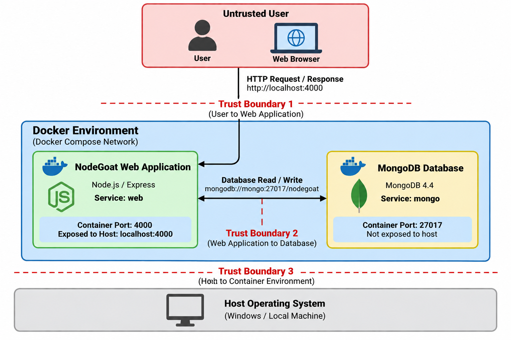

# NodeGoat Application Architecture

## 1. Architecture Overview

The DevSecOps project uses OWASP NodeGoat as the selected open-source application. The application is deployed locally using Docker Compose and consists of a Node.js/Express web application and a MongoDB database.

The two primary services defined in the Docker Compose environment are:

* `web` – NodeGoat Node.js/Express web application
* `mongo` – MongoDB database

Users access the NodeGoat web application through a browser using `http://localhost:4000`.

The web application communicates with the MongoDB service through the Docker network using the MongoDB connection string:

`mongodb://mongo:27017/nodegoat`

MongoDB is not directly exposed to the host through a published port in the current Docker Compose configuration.

## 2. Main Components

### User / Web Browser

The user interacts with NodeGoat through a web browser.

The browser sends HTTP requests to the NodeGoat web application and receives application responses.

### NodeGoat Web Application

The NodeGoat application is implemented using Node.js and Express.js.

The Docker Compose service is named:

`web`

The application is exposed to the host on:

`localhost:4000`

Its responsibilities include:

* Processing HTTP requests
* User authentication
* Application business logic
* Processing user input
* Interacting with the MongoDB database
* Generating responses for the user

### MongoDB Database

MongoDB provides persistent application data storage.

The Docker Compose service is named:

`mongo`

The database listens internally on:

`27017`

The NodeGoat application connects to the database using:

`mongodb://mongo:27017/nodegoat`

## 3. Application Data Flow

The basic application data flow is:

User → Web Browser → NodeGoat Web Application → MongoDB

A typical request follows these steps:

1. The user performs an action through the browser.
2. The browser sends an HTTP request to NodeGoat.
3. The NodeGoat application processes the request.
4. When required, NodeGoat reads from or writes to MongoDB.
5. MongoDB returns the requested data to NodeGoat.
6. NodeGoat processes the result and generates a response.
7. The response is returned to the user's browser.

## 4. Container Architecture

The current Docker environment can be represented as:

Browser / User
|
| HTTP
| localhost:4000
v
+---------------------------+
| NodeGoat Web Container    |
| Service: web              |
| Node.js / Express         |
| Container Port: 4000      |
+-------------+-------------+
|
| MongoDB connection
| mongo:27017
v
+---------------------------+
| MongoDB Container         |
| Service: mongo            |
| MongoDB 4.4               |
| Internal Port: 27017      |
+---------------------------+

Both services communicate through the Docker Compose network.

## 5. Initial Trust Boundaries

The architecture contains several security-relevant boundaries.

### Trust Boundary 1 — User to Web Application

Input crosses from a potentially untrusted user/browser into the NodeGoat application.

Security controls at this boundary may include authentication, authorisation, input validation and output handling.

### Trust Boundary 2 — Web Application to Database

The NodeGoat application communicates with MongoDB across the internal Docker network.

Application-controlled and user-derived data may cross this boundary when database operations are performed.

### Trust Boundary 3 — Host to Container Environment

Docker provides separation between the host operating system and the application's containerised services.

Container configuration, exposed ports, images and privileges therefore form part of the project's security considerations.

## 6. Security Relevance

Understanding these components, data flows and trust boundaries provides the foundation for the project's STRIDE threat model.

The threat-modelling stage will evaluate potential threats involving:

* Spoofing
* Tampering
* Repudiation
* Information Disclosure
* Denial of Service
* Elevation of Privilege

Identified threats will then be assessed according to likelihood and impact and mapped to appropriate security controls.

## Architecture Diagram

