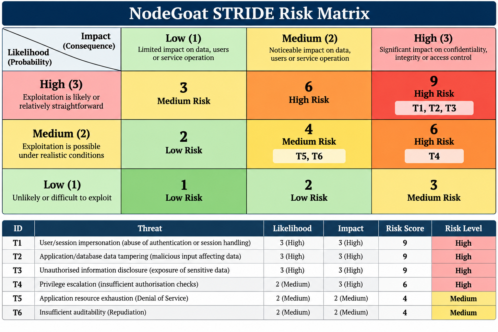

# NodeGoat STRIDE Threat Model

## 1. Purpose

This threat model analyses security threats affecting the OWASP NodeGoat application used in the DevSecOps Security Pipeline project.

The analysis uses the STRIDE methodology to identify threats across the application's components, data flows and trust boundaries.

STRIDE represents:

* **S – Spoofing**
* **T – Tampering**
* **R – Repudiation**
* **I – Information Disclosure**
* **D – Denial of Service**
* **E – Elevation of Privilege**

## 2. System Components

The threat model considers the following components:

1. User / Web Browser
2. NodeGoat Node.js/Express Web Application
3. MongoDB Database
4. Docker Compose Network
5. Host Operating System

The primary data flows are:

* User/Browser ↔ NodeGoat Web Application
* NodeGoat Web Application ↔ MongoDB Database

## 3. Trust Boundaries

### TB1 – User to Web Application

User-controlled input crosses from the browser into the NodeGoat web application.

This boundary is relevant to authentication, authorisation, session handling, input validation and output handling.

### TB2 – Web Application to MongoDB

Application and user-derived data cross between the NodeGoat web application and MongoDB.

This boundary is relevant to database query security, data integrity and access to sensitive information.

### TB3 – Host to Container Environment

The NodeGoat application and MongoDB run within Docker containers on the local host.

This boundary is relevant to container configuration, exposed services, vulnerable images and container privileges.

## 4. Initial STRIDE Threats

| ID | STRIDE Category        | Threat                                                                                                                                                     | Affected Component / Boundary | Likelihood | Impact | Risk   |
| -- | ---------------------- | ---------------------------------------------------------------------------------------------------------------------------------------------------------- | ----------------------------- | ---------- | ------ | ------ |
| T1 | Spoofing               | An attacker may attempt to impersonate another application user by abusing weaknesses in authentication or session handling.                               | NodeGoat / TB1                | High       | High   | High   |
| T2 | Tampering              | Malicious user-controlled input may influence application or database operations and modify data in an unintended way.                                     | NodeGoat → MongoDB / TB2      | High       | High   | High   |
| T3 | Information Disclosure | Inadequate access controls or unsafe application behaviour may expose information that should only be available to authorised users.                       | NodeGoat / MongoDB            | High       | High   | High   |
| T4 | Elevation of Privilege | A normal user may attempt to access functionality or resources intended for users with greater privileges if authorisation checks are insufficient.        | NodeGoat / TB1                | Medium     | High   | High   |
| T5 | Denial of Service      | Repeated or resource-intensive requests may consume application resources and reduce the availability of the NodeGoat service.                             | NodeGoat / TB1                | Medium     | Medium | Medium |
| T6 | Repudiation            | Insufficient security logging may make it difficult to associate sensitive actions with a particular authenticated user or investigate malicious activity. | NodeGoat                      | Medium     | Medium | Medium |

## 5. Risk Assessment Method

A 3 × 3 risk matrix is used.

### Likelihood

| Score | Rating | Description                                          |
| ----- | ------ | ---------------------------------------------------- |
| 1     | Low    | Unlikely or difficult to exploit                     |
| 2     | Medium | Exploitation is possible under realistic conditions  |
| 3     | High   | Exploitation is likely or relatively straightforward |

### Impact

| Score | Rating | Description                                                            |
| ----- | ------ | ---------------------------------------------------------------------- |
| 1     | Low    | Limited security or operational impact                                 |
| 2     | Medium | Noticeable impact on data, users or service operation                  |
| 3     | High   | Significant compromise of confidentiality, integrity or access control |

Risk is calculated as:

**Risk Score = Likelihood × Impact**

The resulting scores are classified as:

| Score | Risk Level |
| ----- | ---------- |
| 1–2   | Low        |
| 3–4   | Medium     |
| 6–9   | High       |

## 6. Threat Risk Register

| ID | Threat                                                  | Likelihood | Impact | Score | Risk Level |
| -- | ------------------------------------------------------- | ---------: | -----: | ----: | ---------- |
| T1 | User/session impersonation                              |          3 |      3 |     9 | High       |
| T2 | Application/database data tampering                     |          3 |      3 |     9 | High       |
| T3 | Unauthorised information disclosure                     |          3 |      3 |     9 | High       |
| T4 | Privilege escalation through insufficient authorisation |          2 |      3 |     6 | High       |
| T5 | Application resource exhaustion                         |          2 |      2 |     4 | Medium     |
| T6 | Insufficient auditability of security-sensitive actions |          2 |      2 |     4 | Medium     |

## 7. Threat-to-Control Mapping

| Threat ID | Security Controls                                                                                |
| --------- | ------------------------------------------------------------------------------------------------ |
| T1        | Strong authentication, secure session handling, credential protection and authentication testing |
| T2        | Input validation, safe database operations, secure coding practices and SAST                     |
| T3        | Authorisation checks, least-privilege access, secure error handling and security testing         |
| T4        | Server-side authorisation checks, role/access validation and secure coding review                |
| T5        | Request validation, resource controls, rate limiting where appropriate and monitoring            |
| T6        | Security logging, audit trails and appropriate monitoring                                        |

## 8. Relationship to DevSecOps Pipeline

The identified threats will guide the security controls implemented throughout the project.

The DevSecOps pipeline will include automated security testing such as:

* Static Application Security Testing (SAST)
* Dependency vulnerability scanning
* Secrets scanning
* Container image vulnerability scanning

The threat model will also guide the selection and analysis of vulnerabilities that will be demonstrated and remediated during the secure coding phase.

As vulnerabilities are investigated, this threat model may be updated with more specific evidence, affected code locations and security controls.

### Risk Matrix

